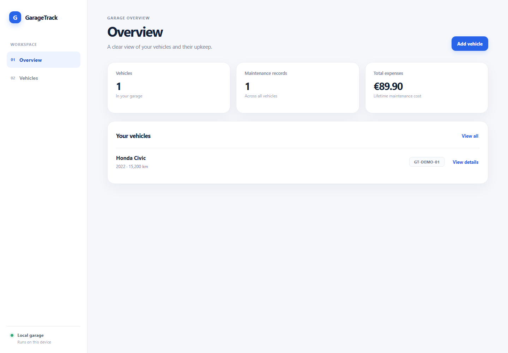

# GarageTrack

GarageTrack is a web app for recording vehicles, tracking maintenance, and reviewing costs. A local installation supports full editing. The public portfolio demo uses synthetic sample data and is read-only.

## Features

- Create, view, update, and delete vehicles.
- Record, view, update, and delete maintenance entries.
- See the maintenance history and total expenses for each vehicle.
- View vehicle, maintenance, and expense totals on the dashboard.
- Explore the public demo without changing its shared sample records.
- Use the API documentation at `/docs`.

The local version is for one user and does not include accounts or authentication. Public writes are disabled in the deployed demo at both the interface and API layers.

## Technologies

- Python 3.12 or newer, FastAPI, Pydantic 2, SQLAlchemy 2, PyMySQL, and Uvicorn
- MySQL Community Server 8 or newer
- HTML, CSS, and JavaScript modules
- Pytest, Ruff, Prettier, ESLint, GitHub Actions, and Node.js built-in test runner

## Architecture

The browser sends JSON requests to the FastAPI application. FastAPI validates request data with Pydantic schemas, calls small service functions, and uses SQLAlchemy sessions to read and update MySQL. FastAPI also serves the static frontend, so the browser and API share the same local origin.

```text
GarageTrack/
├── .github/workflows/quality.yml
├── .dockerignore
├── Dockerfile
├── backend/
│   ├── app/
│   │   ├── main.py
│   │   ├── config.py
│   │   ├── database.py
│   │   ├── init_db.py
│   │   ├── models.py
│   │   ├── schemas.py
│   │   ├── seed_demo.py
│   │   ├── startup.py
│   │   ├── routers/
│   │   │   ├── configuration.py
│   │   │   ├── maintenance.py
│   │   │   ├── statistics.py
│   │   │   └── vehicles.py
│   │   └── services/
│   │       ├── maintenance.py
│   │       ├── statistics.py
│   │       └── vehicles.py
│   ├── requirements.txt
│   └── tests/
│       ├── conftest.py
│       ├── integration/
│       │   ├── test_demo_mode.py
│       │   ├── test_demo_seed.py
│       │   └── test_startup.py
│       └── unit/
├── frontend/
│   ├── assets/dashboard.png
│   ├── index.html
│   ├── styles.css
│   ├── js/
│   │   ├── api.js
│   │   ├── app.js
│   │   └── form_data.js
│   ├── test/
│   ├── eslint.config.js
│   ├── package.json
│   └── package-lock.json
├── .env.example
├── .gitignore
├── pyproject.toml
└── README.md
```

`backend/app/models.py` is the source of truth for the database tables. `backend/app/init_db.py` explicitly creates missing tables; the API does not create tables during requests. The project does not include a migration system because the initial schema is small.

## Data model

```text
vehicles 1 ───── many maintenance_records
```

| Table                 | Main columns                                                                                 | Purpose                                                                                          |
| --------------------- | -------------------------------------------------------------------------------------------- | ------------------------------------------------------------------------------------------------ |
| `vehicles`            | `id`, `brand`, `model`, `year`, `license_plate`, `current_mileage`                           | Stores each vehicle. The optional plate is unique; year and mileage are validated.               |
| `maintenance_records` | `id`, `vehicle_id`, `maintenance_type`, `maintenance_date`, `mileage`, `cost`, `description` | Stores services for a vehicle. `vehicle_id` references `vehicles.id`; costs use `DECIMAL(10,2)`. |

Both tables use InnoDB, primary keys, and check constraints for non-negative mileage and cost. The foreign key uses `RESTRICT`: a vehicle with maintenance entries must have those entries deleted first. This prevents accidental loss of history. The expense queries use `SUM`, `COUNT`, `LEFT OUTER JOIN`, and `GROUP BY` so vehicles without maintenance still appear with zero cost.

## API

All application routes use the `/api/v1` prefix. Request and response bodies use JSON.

| Method   | Endpoint                                    | Purpose                                       |
| -------- | ------------------------------------------- | --------------------------------------------- |
| `GET`    | `/api/v1/vehicles`                          | List vehicles                                 |
| `GET`    | `/api/v1/vehicles/{vehicle_id}`             | Get one vehicle                               |
| `POST`   | `/api/v1/vehicles`                          | Create a vehicle                              |
| `PUT`    | `/api/v1/vehicles/{vehicle_id}`             | Replace vehicle details                       |
| `DELETE` | `/api/v1/vehicles/{vehicle_id}`             | Delete a vehicle without maintenance entries  |
| `GET`    | `/api/v1/vehicles/{vehicle_id}/maintenance` | Get maintenance history                       |
| `POST`   | `/api/v1/vehicles/{vehicle_id}/maintenance` | Add a maintenance entry                       |
| `PUT`    | `/api/v1/maintenance/{maintenance_id}`      | Update a maintenance entry                    |
| `DELETE` | `/api/v1/maintenance/{maintenance_id}`      | Delete a maintenance entry                    |
| `GET`    | `/api/v1/vehicles/{vehicle_id}/expenses`    | Get one vehicle's expense total               |
| `GET`    | `/api/v1/statistics`                        | Get dashboard totals and per-vehicle expenses |
| `GET`    | `/api/v1/config`                            | Read the public demo mode                     |
| `GET`    | `/health`                                   | Check that the web service responds           |

FastAPI publishes the OpenAPI interface at `/docs` and `/openapi.json`.

## Public demo

The public demo is deployed from the root `Dockerfile`. The container waits for MySQL, creates any missing tables from the SQLAlchemy models, and inserts two synthetic vehicles and three service records only when `DEMO_READ_ONLY=true` and the database is empty. The image defaults to read-only mode. Write requests receive HTTP `403` even if they bypass the frontend.

To host the demo on Railway:

1. Create a project and add Railway's MySQL service. Keep its network private and use the database name `garagetrack`.
2. Keep the MySQL volume mounted at `/var/lib/mysql` so its files survive container restarts.
3. Deploy the public GarageTrack repository from its `main` branch. Railway detects the Dockerfile and builds the app service.
4. In the app service, set `DATABASE_URL` to the MySQL service reference `${{MySQL.MYSQL_URL}}` and set `DEMO_READ_ONLY` to `true`. Name the database service `MySQL` or update the reference to match its name.
5. Generate an HTTPS public domain for the app service. The same domain serves the interface, `/health`, and `/docs`.

The GitHub source and the Railway demo are public, so the demo contains only synthetic records. Do not store real vehicle information there. Railway's Free plan currently includes $1 of monthly usage credit; services can stop when credits run out. Trial volumes are deleted 30 days after the trial credits expire. A sleeping service may take extra time to answer its first request. Check [Railway pricing](https://docs.railway.com/pricing/plans), [trial limits](https://docs.railway.com/pricing/free-trial), and [MySQL setup](https://docs.railway.com/databases/mysql) before relying on the public URL.

## Windows setup

### Requirements

- Python 3.12 or newer
- MySQL Community Server 8 or newer
- Node.js 24 or newer and npm, for frontend quality checks
- Git

The app runs on `127.0.0.1:8000`. The example environment file uses MySQL on `127.0.0.1:3307`; change the port in `.env` if your MySQL server uses `3306`.

### Create the MySQL databases and users

Connect to MySQL as an administrator and run the following SQL. Replace each example password with a different local password.

```sql
CREATE DATABASE garagetrack CHARACTER SET utf8mb4 COLLATE utf8mb4_0900_ai_ci;
CREATE DATABASE garagetrack_test CHARACTER SET utf8mb4 COLLATE utf8mb4_0900_ai_ci;

CREATE USER 'garagetrack_app'@'127.0.0.1' IDENTIFIED BY 'replace-with-a-local-password';
GRANT SELECT, INSERT, UPDATE, DELETE, CREATE ON garagetrack.* TO 'garagetrack_app'@'127.0.0.1';

CREATE USER 'garagetrack_test'@'127.0.0.1' IDENTIFIED BY 'replace-with-a-different-password';
GRANT ALL PRIVILEGES ON garagetrack_test.* TO 'garagetrack_test'@'127.0.0.1';
```

The application user has only the permissions needed for normal queries and the explicit first-run table creation. The test user can access only `garagetrack_test`. Integration tests verify the database name, MySQL driver, and local host before they recreate tables.

Docker Desktop is optional. To run MySQL in a local container, use a local-only port binding and a named data volume:

```powershell
docker run --name garagetrack-mysql --publish 127.0.0.1:3307:3306 --volume garagetrack-mysql-data:/var/lib/mysql --env MYSQL_ROOT_PASSWORD=replace-this-local-password --detach mysql:8.4
```

If Docker Desktop is used on Windows, its WSL 2 backend must be available. The application itself does not require Docker.

### Install and configure

Run these commands from the project root in PowerShell:

```powershell
py -3.12 -m venv .venv
.\.venv\Scripts\python.exe -m pip install --requirement .\backend\requirements.txt
Copy-Item .env.example .env
```

Edit `.env` with the two MySQL passwords. `DATABASE_URL` must use `garagetrack_app`; `TEST_DATABASE_URL` must use `garagetrack_test`. `.env` is ignored by Git. Never commit real credentials.

Initialize the schema once:

```powershell
Set-Location .\backend
..\.venv\Scripts\python.exe -m app.init_db
```

Start the application from the `backend` directory:

```powershell
..\.venv\Scripts\python.exe -m uvicorn app.main:app --host 127.0.0.1 --port 8000
```

Open `http://127.0.0.1:8000` for the app or `http://127.0.0.1:8000/docs` for the API interface. Press `Ctrl+C` to stop Uvicorn.

## Tests and quality checks

Run backend unit and integration tests from the project root:

```powershell
.\.venv\Scripts\python.exe -m pytest .\backend\tests\unit
.\.venv\Scripts\python.exe -m pytest .\backend\tests\integration
```

Integration tests use the real MySQL server, not SQLite. Before each test, they create tables in `garagetrack_test`; after the test, they drop those tables. The fixture rejects any database URL whose database name is not exactly `garagetrack_test`.

Run Python checks:

```powershell
.\.venv\Scripts\python.exe -m ruff check .
.\.venv\Scripts\python.exe -m ruff format --check .
```

Run frontend checks from `frontend`:

```powershell
npm ci
npm test
npm run lint
npm run format:check
```

The JavaScript tests use Node's built-in `node:test`. They cover HTTP methods, JSON request bodies, `204` responses, API errors, connection failures, and form-value conversion. Unit tests cover Pydantic validation. MySQL integration tests cover persistence, HTTP responses, relationships, deletion rules, and expense totals.

## TDD and project history

The changes were developed in small `RED → GREEN → REFACTOR` steps. For example, vehicle schema tests were committed before vehicle validation; maintenance schema tests were committed before maintenance validation; and API integration tests were committed before the routes and services. The frontend request and form tests were also recorded before their modules. The `development` branch contains the work in Conventional Commit order; `main` is kept as the stable branch.

The integration test fixture overrides the API's normal SQLAlchemy session with a session connected to the separate MySQL test database. This verifies FastAPI, SQLAlchemy, PyMySQL, MySQL constraints, and JSON responses together.

## CI and delivery

The GitHub Actions workflow runs on pull requests, pushes to `main`, and manual runs. It installs the pinned Python and JavaScript dependencies, checks Ruff, Prettier, and ESLint, runs frontend and unit tests, runs MySQL integration tests against a temporary MySQL 8.4 service, and builds the Docker image to verify the public demo package.

After all checks pass on a push to `main`, the delivery job archives the committed project files and uploads a ZIP artifact associated with that commit. The artifact expires after 90 days. This repository and its artifact are public, so anyone with repository read access can download the ZIP. The package contains only tracked files; the workflow fails if `.env`, `.local`, `.venv`, or `node_modules` is tracked. It does not include database contents or credentials.

The delivery package is a public source archive associated with its commit, not a deployed image. GitHub artifacts are available to repository readers and expire after 90 days. The first published run for commit `1a58e94` passed its quality checks, including the MySQL tests and Docker build, and uploaded the source archive in [GitHub Actions](https://github.com/JGdg9/GarageTrack/actions/runs/42624838253). Each later change has its own run result.

## Real application capture

The dashboard capture below was taken from the locally running app with temporary demonstration records. Those records were removed from the development database after capture; the application does not seed permanent sample data.



## How to explain GarageTrack

### Request flow

When a user saves a vehicle, `frontend/js/app.js` reads the form and `frontend/js/form_data.js` normalizes its values. `frontend/js/api.js` sends JSON with `fetch()` to `POST /api/v1/vehicles`. The FastAPI router receives a Pydantic `VehicleCreate` schema, calls `backend/app/services/vehicles.py`, and SQLAlchemy writes the `Vehicle` model to MySQL. FastAPI returns JSON, and the frontend updates the page using DOM elements and `textContent`.

### Interview notes

- **What problem does it solve?** It keeps vehicle details, service history, and maintenance costs in one local app.
- **What does the frontend do?** It presents the dashboard, vehicle list, and vehicle detail view; collects input; calls the API; and reports loading, success, and error states.
- **What does the backend do?** FastAPI validates requests, runs the business operations, queries MySQL, and returns HTTP responses.
- **What is a REST API?** It exposes resources through URLs and HTTP methods. For example, `POST /api/v1/vehicles` creates a vehicle and `GET /api/v1/vehicles/{vehicle_id}` reads one.
- **Why FastAPI, Pydantic, and SQLAlchemy?** FastAPI maps HTTP requests to Python functions, Pydantic validates JSON fields, and SQLAlchemy maps Python models to parameterized SQL queries.
- **How does Python connect to MySQL?** `backend/app/database.py` creates one SQLAlchemy engine from `DATABASE_URL`; PyMySQL is the MySQL driver; each request receives a managed SQLAlchemy session.
- **What do the tables and keys do?** `vehicles.id` uniquely identifies a vehicle. `maintenance_records.vehicle_id` references it, enforcing the one-to-many relationship. `ON DELETE RESTRICT` protects its history.
- **How are expenses calculated?** SQL `SUM` adds `DECIMAL(10,2)` maintenance costs. `LEFT OUTER JOIN` and `COALESCE` keep vehicles with no records in the statistics.
- **How is the public demo protected?** `backend/app/config.py` reads `DEMO_READ_ONLY`; mutation routes reject writes and the frontend hides edit controls. `backend/app/seed_demo.py` inserts sample data once when the demo database is empty.
- **What do HTTP status codes communicate?** `201` means created, `204` means deleted without a response body, `404` means missing, `409` means a conflict such as a duplicate plate or blocked vehicle deletion, and `422` means invalid input.
- **How were the tests written?** TDD records expected behavior first, checks the intended failure, implements the smallest change, and reruns tests after refactoring. Unit tests cover validation; integration tests exercise the real MySQL database through FastAPI.
- **What does CI do?** It runs code style checks and automated tests for each pull request and main-branch push.
- **What does CD do?** After CI passes on `main`, it packages that commit and stores a downloadable versioned ZIP artifact.
- **Why this architecture?** Separate routers, services, schemas, and database models keep HTTP handling, business operations, validation, and persistence understandable without extra framework layers.

### LinkedIn summary

> I built GarageTrack, a local vehicle-maintenance tracker using Python, FastAPI, MySQL, and a responsive HTML/CSS/JavaScript interface. It supports vehicle and maintenance CRUD, decimal expense totals, a REST API, unit and MySQL integration tests, and GitHub Actions CI. I focused on keeping the code small, readable, and easy to explain.
